<div align="center">

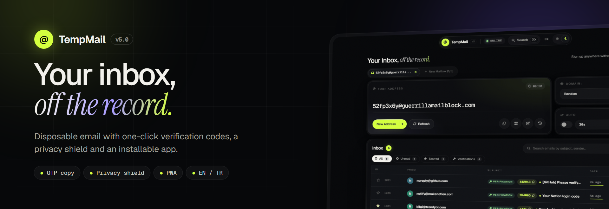

<br />

[](#-changelog)
[](https://mehmetkahya0.github.io/temp-mail/)
[](#-installable-pwa)
[](LICENSE)


[](https://github.com/mehmetkahya0/temp-mail/stargazers)
[](https://github.com/mehmetkahya0/temp-mail/network/members)
[](https://github.com/mehmetkahya0/temp-mail/issues)
[](https://github.com/mehmetkahya0/temp-mail/commits/main)

### **[🚀 Open the app](https://mehmetkahya0.github.io/temp-mail/)** &nbsp;·&nbsp; [🐞 Report a bug](https://github.com/mehmetkahya0/temp-mail/issues) &nbsp;·&nbsp; [💡 Request a feature](https://github.com/mehmetkahya0/temp-mail/issues)

</div>

> [!IMPORTANT]
> ALL CODE FOR THIS WEBSITE IS COPYRIGHTED. YOU CANNOT USE THESE CODES AND OPEN ANOTHER WEBSITE IN THE SAME WAY. IT IS BEING TRACKED WITH VARIOUS TOOLS AND IF IT IS OPENED, A DMCA VIOLATION WILL BE SENT WITH MY LAWYER. SCANS ARE CARRIED OUT REGULARLY WITH VARIOUS TOOLS.
>
> PLEASE READ THE [LICENSE](LICENSE)

<br />

## 📑 Table of contents

<table>
<tr>
<td valign="top" width="33%">

**Overview**
- [At a glance](#-at-a-glance)
- [Use cases](#-use-cases)
- [Feature matrix](#-feature-matrix)
- [Screenshots](#-screenshots)
- [What's new in V5](#-whats-new-in-v5)
- [Quick start](#-quick-start)

</td>
<td valign="top" width="33%">

**Features**
- [Address & mailboxes](#-address--mailboxes)
- [One-click verification codes](#-one-click-verification-codes)
- [Smart tags & filters](#%EF%B8%8F-smart-tags--filters)
- [Split reader](#-split-reader)
- [Privacy shield](#%EF%B8%8F-privacy-shield)
- [Link safety](#-link-safety)
- [Notifications & expiry](#-notifications--expiry)
- [Address history](#-address-history)
- [Keyboard & command palette](#%EF%B8%8F-keyboard--command-palette)
- [Themes](#-themes)
- [Mobile](#-mobile)
- [Installable PWA](#-installable-pwa)
- [Languages](#%EF%B8%8F-languages)

</td>
<td valign="top" width="33%">

**Reference**
- [Project structure](#-project-structure)
- [Architecture](#-architecture)
- [How it works](#%EF%B8%8F-how-it-works)
- [Security model](#-security-model)
- [Network & third parties](#-network--third-parties)
- [API endpoints](#-api-endpoints)
- [Configuration](#%EF%B8%8F-configuration)
- [Local storage](#-local-storage)
- [Design system](#-design-system)
- [Accessibility](#-accessibility)
- [Browser requirements](#-browser-requirements)
- [Project stats](#-project-stats)
- [Development](#%EF%B8%8F-development)
- [Deployment & releases](#-deployment--releases)
- [Known limitations](#%EF%B8%8F-known-limitations)
- [FAQ & troubleshooting](#-faq--troubleshooting)
- [Changelog](#-changelog)

</td>
</tr>
</table>

<br />

## 📊 At a glance

<div align="center">

| 📬 Mailboxes | 🌐 Domains | 🗣️ Languages | ⌨️ Shortcuts | 🧩 Dependencies | 🛠️ Build steps | ⏳ Mail lifetime |
|:---:|:---:|:---:|:---:|:---:|:---:|:---:|
| **5** at once | **7** | **EN · TR** | **12** | **0** | **0** | **60 min** |

</div>

TempMail is a privacy-first **disposable email web app**. It creates a throwaway address instantly, shows incoming mail live, pulls out verification codes for you, and blocks the trackers that usually come with sign-up mail. It has **no backend and no accounts**: the browser talks directly to the [Guerrilla Mail API](https://www.guerrillamail.com/), and everything TempMail remembers stays in your browser.

<br />

## 🎯 Use cases

| You want to… | TempMail gives you |
|---|---|
| Sign up for a trial, forum or Wi-Fi portal without handing out your real address | An address in one click, gone after you leave |
| Get past a "verify your email" step fast | The code as a chip in the inbox — one click to copy |
| Test your own app's sign-up, password-reset or newsletter mail | Up to 5 inboxes in tabs, `.eml` export, attachment download |
| Open a mail you don't trust | Trackers stripped, remote images held back, risky links flagged |
| Use it on your phone | Card layout, bottom-sheet reader, installable as an app |

<br />

## 🧮 Feature matrix

| Feature | 🖥️ Desktop | 📱 Mobile | ⌨️ Keyboard | 🎛️ Palette | 💾 Remembered |
|---|:---:|:---:|:---:|:---:|:---:|
| New address | ✅ | ✅ FAB | <kbd>N</kbd> | — | ✅ |
| Custom username / domain | ✅ | ✅ | — | — | ✅ |
| Copy address | ✅ | ✅ FAB | <kbd>C</kbd> | ✅ | — |
| QR code | ✅ | ✅ | — | — | — |
| Multiple mailboxes (5) | ✅ | ✅ | — | ✅ | ✅ |
| Auto-refresh | ✅ | ✅ | — | — | ✅ |
| Verification-code chip | ✅ | ✅ | — | ✅ *latest* | — |
| Split reader | ✅ ≥ 1100 px | sheet | <kbd>Enter</kbd> | — | — |
| Star / unread | ✅ | ✅ | <kbd>S</kbd> | — | ✅ |
| Search | ✅ | ✅ | <kbd>/</kbd> | ✅ | — |
| Privacy shield | ✅ | ✅ | — | ✅ toggle | ✅ |
| Link safety | ✅ | ✅ | — | — | — |
| Address history (20) | ✅ | ✅ | — | ✅ | ✅ |
| Desktop notifications | ✅ | browser-dependent | — | ✅ | ✅ |
| Theme | ✅ | ✅ | — | ✅ | ✅ |
| Language EN / TR | ✅ | ✅ | — | ✅ | ✅ |
| Install as app | ✅ | ✅ | — | ✅ | — |

<br />

## 📸 Screenshots

<table>
  <tr>
    <td colspan="2">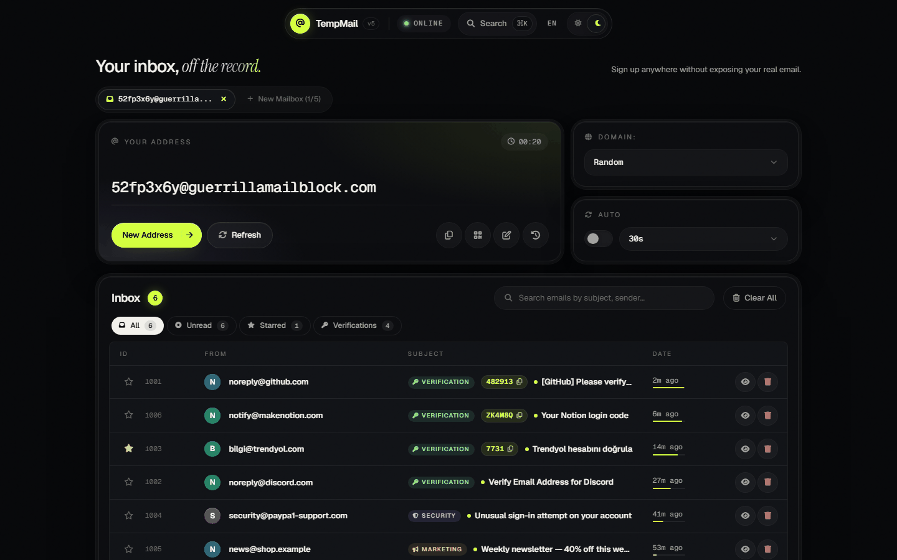</td>
  </tr>
  <tr>
    <td colspan="2" align="center"><sub><b>Inbox</b> — code chips, smart tags, unread dots and per-mail expiry meters</sub></td>
  </tr>
  <tr>
    <td width="50%">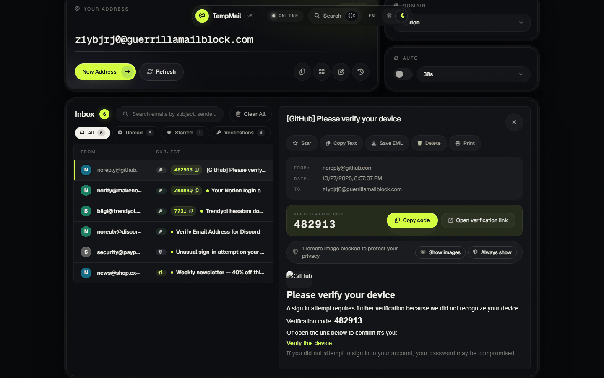</td>
    <td width="50%">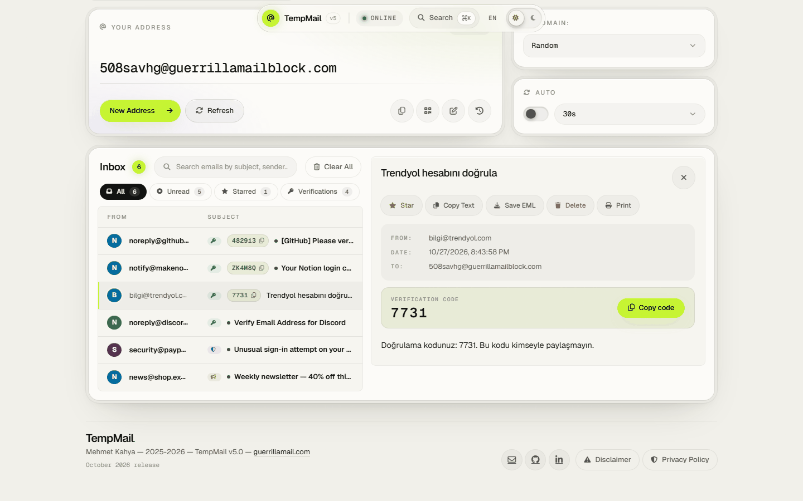</td>
  </tr>
  <tr>
    <td align="center"><sub><b>Split reader</b> — code strip + privacy shield</sub></td>
    <td align="center"><sub><b>Light theme</b> — Turkish code detected</sub></td>
  </tr>
  <tr>
    <td width="50%">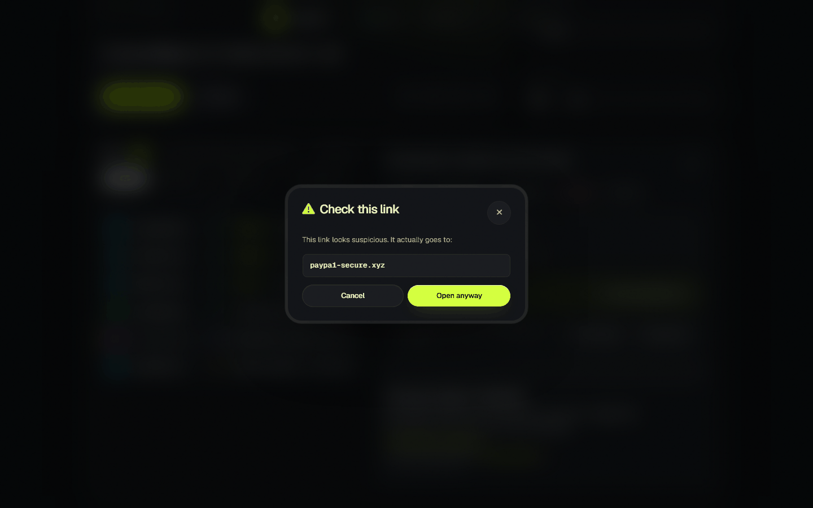</td>
    <td width="50%">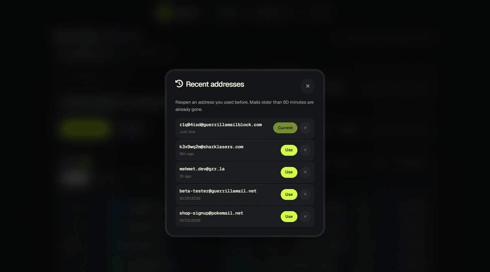</td>
  </tr>
  <tr>
    <td align="center"><sub><b>Link safety</b> — a spoofed PayPal link caught</sub></td>
    <td align="center"><sub><b>Address history</b> — reopen your last 20 addresses</sub></td>
  </tr>
  <tr>
    <td width="50%">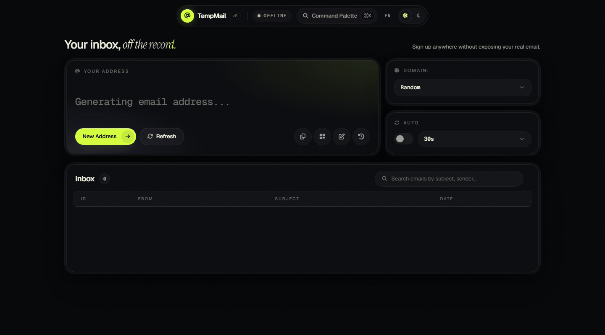</td>
    <td width="50%">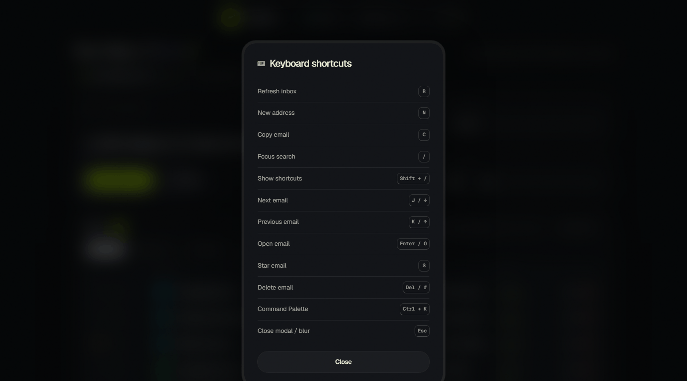</td>
  </tr>
  <tr>
    <td align="center"><sub><b>Command palette</b> — <kbd>Ctrl</kbd>/<kbd>⌘</kbd> + <kbd>K</kbd></sub></td>
    <td align="center"><sub><b>Shortcuts</b> — <kbd>?</kbd></sub></td>
  </tr>
</table>

<div align="center">
  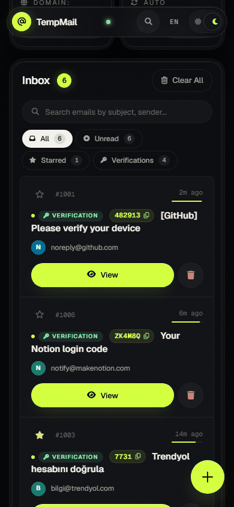
  &nbsp;
  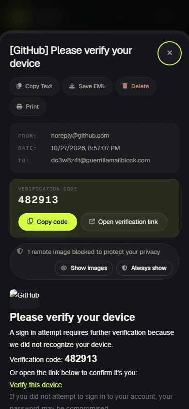
  &nbsp;
  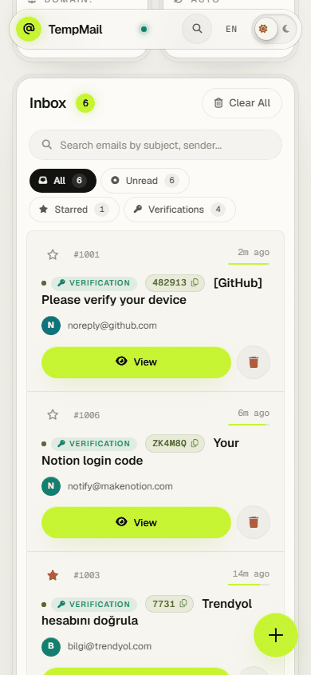
  <br />
  <sub><b>Mobile</b> — card inbox · bottom-sheet reader · light theme</sub>
</div>

<br />

## 🆕 What's new in V5

V5 is built around one observation: **people open a temporary inbox to get a code and leave.** Every change shortens that path or makes it safer.

| Area | V4 | **V5** |
|---|---|---|
| 🎨 **Design** | Glassmorphism, blue / indigo, landing-page sized | **"Obsidian Signal"** — OLED black, electric-lime accent, paper light theme, app-density layout |
| 🔑 **Verification codes** | Mail tagged only | **Detected, shown as a chip, copied in one click**; code strip and verify-link button in the reader |
| 📖 **Reading** | Modal, opened by double-click | **Split reader pane** on wide screens · single click · bottom sheet on mobile |
| 🛡️ **Trackers & images** | Loaded automatically | **Tracking pixels stripped, remote images blocked** until you allow them |
| 🔗 **Suspicious links** | — | **Flagged and confirmed** (shorteners, IPs, punycode, text ≠ real target) |
| 🔔 **Notifications** | Always; permission prompt 10 s after load | **Only when the tab is in the background**; asked when you enable auto-refresh |
| 📬 **Inbox state** | Stars | **+ read / unread, Unread filter, address history** |
| ⏳ **Lifetime** | — | **Per-mail 60-minute expiry meter** |
| ⌨️ **Keyboard** | R · N · C · / · ? | **+ J · K · ↑ · ↓ · Enter · O · S · Del · #** |
| 📲 **Install** | — | **PWA** with offline app shell and a *New address* shortcut |
| 🐞 **Fixes** | Dates could read *01.01.1970* | Missing dates show `—`; *Copy text* always copies the open mail |

<br />

## 🚀 Quick start

```bash
git clone https://github.com/mehmetkahya0/temp-mail.git
cd temp-mail

# any static server bound to 127.0.0.1
python -m http.server 8080 --bind 127.0.0.1
# or
npx live-server --host=127.0.0.1 --port=8080
```

Open **http://127.0.0.1:8080**.

> [!NOTE]
> Opening `index.html` from the file system **won't work**. ES modules and service workers need HTTP, and the domain guard only allows `127.0.0.1` and the official site.

> [!TIP]
> The service worker caches the app shell. While developing, hard-reload (<kbd>Ctrl</kbd>+<kbd>Shift</kbd>+<kbd>R</kbd>) or enable **Update on reload** in DevTools → Application → Service Workers.

<br />

---

# ✨ Features

## 📬 Address & mailboxes

The address card is the heart of the app. One click on **New Address** gives you a fresh inbox; the four round buttons copy it, show it as a QR code, set a custom username, or open your address history.

| Capability | Details |
|---|---|
| **Instant address** | Created on first visit; new one any time with **New Address** or <kbd>N</kbd> |
| **Custom username** | Pick the part before `@` (pencil button) |
| **Domain choice** | Random, or any of the 7 domains below |
| **QR code** | Scan the address onto your phone, or download the QR image |
| **Multiple mailboxes** | Up to **5** addresses in tabs, each with its own inbox, cache and timer |
| **Auto-refresh** | Off by default; every **10 s · 30 s · 1 min · 2 min** with a progress bar |

<details>
<summary><b>Available domains</b></summary>

<br />

| Domain | Domain |
|---|---|
| `guerrillamail.com` | `grr.la` |
| `guerrillamail.net` | `pokemail.net` |
| `guerrillamail.org` | `spam4.me` |
| `guerrillamailblock.com` | |

</details>

<details>
<summary><b>How mailbox tabs are stored</b></summary>

<br />

Each tab is one Guerrilla Mail session. Tabs live in `temp_mail_sessions_v4` as an array; switching tabs swaps the active session into the single-session keys the rest of the app reads.

```jsonc
// temp_mail_sessions_v4
[
  {
    "email": "k3x9q2ab@grr.la",        // address shown in the card
    "sessionId": "…",                  // Guerrilla Mail sid_token
    "knownIds": ["123", "124"],        // mail IDs already seen (new-mail detection)
    "sessionStart": "1761590400000",   // ms timestamp, drives the session timer
    "cache": "[…]"                     // last inbox list, shown when offline
  }
]
// temp_mail_current_session_index → "0"
```

| Event | Effect |
|---|---|
| **＋ tab** | New session + random address; refused at **5** tabs |
| **Switch tab** | Current tab saved, chosen tab's session, cache and timer restored, inbox refreshed |
| **✕ tab** | Session removed; if it was active, the last tab takes over. Closing the only tab starts a fresh address |
| **First visit after V3** | A legacy single session is migrated into the tab array automatically |

</details>

<br />

## 🔑 One-click verification codes


TempMail reads each mail's subject and preview and pulls out the code for you. In the inbox it appears as a **lime chip** next to the subject — one click copies it. Opening the mail shows the code in large type with **Copy code** and, when found, **Open verification link**. The command palette also has **Copy latest code**.

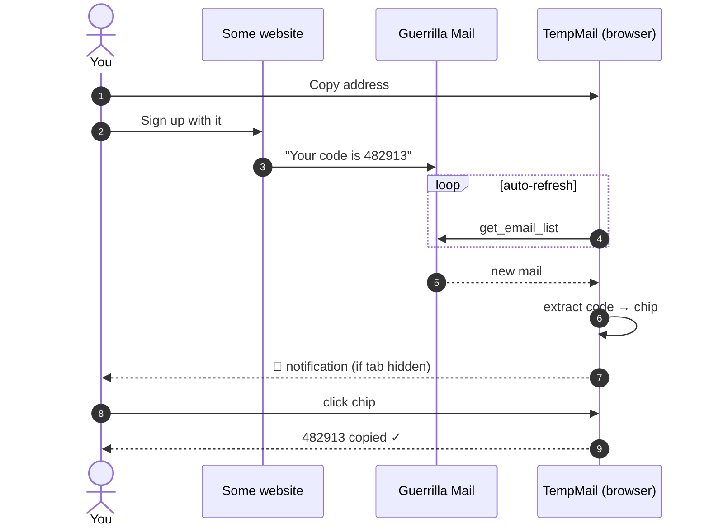

**How detection works**

| Step | Rule |
|---|---|
| 1. Find a keyword | `code`, `otp`, `pin`, `verification`, `passcode`, `token`, and Turkish stems with suffixes: `kod…`, `doğrulama…`, `onay…`, `şifre…` |
| 2. Look ahead | Search the next **80 characters** after the keyword |
| 3. Match a code | **4–8 digits**, or **5–8 uppercase letters + digits** (must contain both) |
| 4. Skip years | 4-digit values **1900–2099** are never returned |
| 5. Fallback | No keyword? Accept a standalone **6-digit** number |
| Link | First `http(s)` link whose URL or text contains `verify`, `confirm`, `activate`, `validate`, `doğrula`, `onayla`, `magic` or `login` |

**Examples** (from the test suite)

| Mail text | Detected |
|---|:---:|
| `Your verification code is 482913` | **`482913`** |
| `Use code AB12CD to sign in` | **`AB12CD`** |
| `Kodunuz: 7731` | **`7731`** |
| `Giriş kodu 5521` | **`5521`** |
| `Şifreniz: 4410` | **`4410`** |
| `Your Discord code: 2024 … real code 553201` | **`553201`** |
| `Welcome to Guerrilla Mail © 2024` | — |
| `Follow us on Pinterest 2023` | — |

<br />

## 🏷️ Smart tags & filters

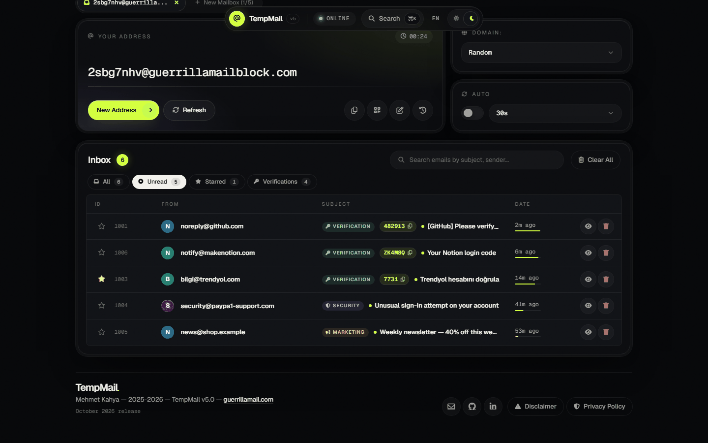

Every mail is tagged from its subject and sender, then you can slice the inbox with filter chips.

| Tag | Triggered by (subject / sender, EN + TR) |
|---|---|
| 🔑 **Verification** | verify, code, otp, pin, activation, confirm, password, sign up, welcome, onay, doğrula, şifre, kayıt, hoş geldin |
| 🛡️ **Security** | security, alert, warn, suspicious, login, reset, 2fa, mfa, güvenlik, uyarı, giriş |
| 🧪 **Testing** | test, demo, sandbox, dummy, trial, deneme |
| 📣 **Marketing** | newsletter, offer, discount, promo, deal, sale, bülten, kampanya, indirim, fırsat |

| Filter | Shows |
|---|---|
| **All** | Everything in the current mailbox |
| **Unread** | Mail you haven't opened (bold, with a lime dot) |
| **Starred** | Mail you starred — kept across visits |
| **Verifications** | Mail tagged 🔑 |

Search (<kbd>/</kbd>) filters by subject and sender as you type.

<br />

## 📖 Split reader


On screens **1100 px and wider**, a single click opens mail in a pane beside the list; the list narrows to sender and subject so both stay readable. Smaller screens use a modal, which becomes a **bottom sheet** on phones.

| Action | Where |
|---|---|
| ⭐ Star | Reader toolbar (pane), row star, <kbd>S</kbd> |
| 📋 Copy text | Copies the body of *this* mail |
| 💾 Save EML | Downloads the mail as an `.eml` file |
| 🗑️ Delete | Toolbar, row, <kbd>Del</kbd> / <kbd>#</kbd> |
| 🖨️ Print | Print-friendly view |
| 📎 Attachments | Listed under the body, one click to download |

<br />

## 🛡️ Privacy shield

Sign-up mail is full of tracking. TempMail cleans every mail **before it is shown**:

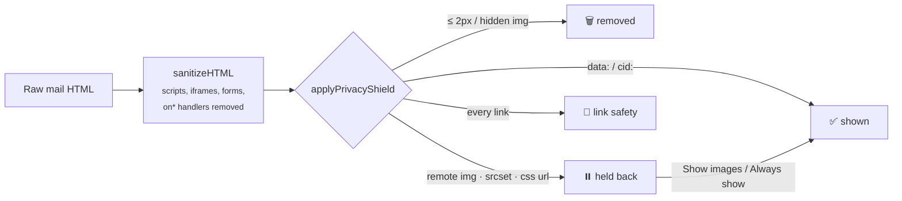

| Content | Default | You can |
|---|---|---|
| Tracking pixels (width/height ≤ 2 px, hidden) | **Removed** | — |
| Remote ``, `<picture>`, `srcset` | **Blocked** | *Show images* for this mail |
| CSS `url(…)` in inline styles / `<style>`, `background=` | **Blocked** | *Always show* to change the default |
| `data:` and `cid:` images | Shown | — |
| Scripts, iframes, objects, forms, inline event handlers | **Removed** | — |

The banner tells you how many items were held back. The **Always show** choice is stored on your device and can be toggled from the command palette.

<br />

## 🔗 Link safety


Every external link opens in a new tab with `noopener noreferrer nofollow` and shows its **real host** on hover. Links that look risky get a dotted amber underline and a ⚠ mark; clicking one shows where it really goes before anything opens.

| Flagged when | Example |
|---|---|
| Visible text names a different domain than the target | text `https://paypal.com/signin` → goes to `paypa1-secure.xyz` |
| URL shortener | `bit.ly`, `t.co`, `tinyurl.com`, `goo.gl`, `ow.ly`, `is.gd`, `buff.ly`, `cutt.ly`, `rebrand.ly`, `shorturl.at`, `rb.gy`, `t.ly` |
| Raw IP address | `http://192.168.4.20/x` |
| Punycode (look-alike letters) | any label starting with `xn--` |
| *Not* flagged | `github.com` text → `www.github.com` link (same site) |

<br />

## 🔔 Notifications & expiry

| Situation | What happens |
|---|---|
| New mail, **tab visible** | Toast + confetti, inbox updates |
| New mail, **tab in background** | Desktop notification (sender — subject) + tab title becomes `(2) TempMail` |
| Click the notification | Window focuses and the mail opens |
| Return to the tab | Counter clears |
| Permission | Requested only when you **enable auto-refresh** or choose it in the command palette — never on page load |

Guerrilla Mail deletes each message **60 minutes after it arrives**. The slim bar under each date shows the time left:

| Time left | Meter |
|---|---|
| 60 → 10 min |  lime, shrinking |
| < 10 min |  amber |
| Hover | "Deletes in *N* min" |

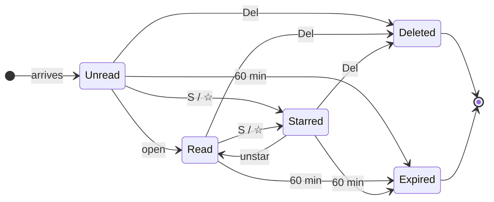

<br />

## 🕘 Address history


Your last **20** addresses are kept (newest first). Open the list with the clock button on the address card or **Address history** in the command palette, then **Use** to switch back to one or **✕** to forget it.

> [!NOTE]
> Reopening an address gives you the inbox again, but mail older than 60 minutes has already been deleted by Guerrilla Mail.

<br />

## ⌨️ Keyboard & command palette

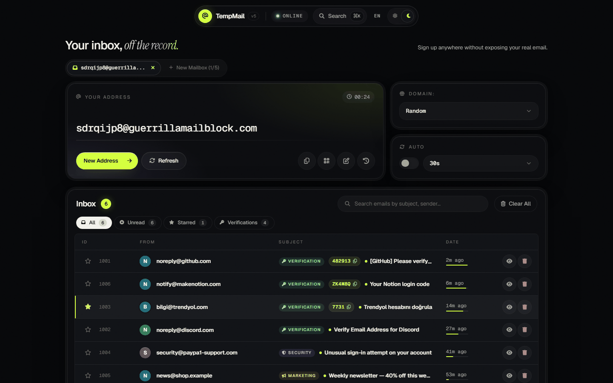

<table>
  <tr><th colspan="2">Global</th><th colspan="2">Inbox</th></tr>
  <tr><td><kbd>Ctrl</kbd>/<kbd>⌘</kbd> + <kbd>K</kbd></td><td>Command palette</td><td><kbd>J</kbd> / <kbd>↓</kbd></td><td>Next mail</td></tr>
  <tr><td><kbd>N</kbd></td><td>New address</td><td><kbd>K</kbd> / <kbd>↑</kbd></td><td>Previous mail</td></tr>
  <tr><td><kbd>C</kbd></td><td>Copy address</td><td><kbd>Enter</kbd> / <kbd>O</kbd></td><td>Open selected</td></tr>
  <tr><td><kbd>R</kbd></td><td>Refresh</td><td><kbd>S</kbd></td><td>Star selected</td></tr>
  <tr><td><kbd>/</kbd></td><td>Search</td><td><kbd>Del</kbd> / <kbd>#</kbd></td><td>Delete selected</td></tr>
  <tr><td><kbd>?</kbd></td><td>Shortcut sheet</td><td><kbd>Esc</kbd></td><td>Close dialog / leave search</td></tr>
</table>

<sub>Arrow keys only take over after a mail is selected (start with <kbd>J</kbd>), so normal page scrolling keeps working. Shortcuts are ignored while you type in a field or while a dialog is open.</sub>

**Command palette actions**

| Group | Commands |
|---|---|
| **Action** | Copy email address · Refresh inbox · Add new mailbox tab · Copy latest code · Install app *(when the browser offers it)* |
| **Settings** | Toggle theme · Toggle language · Enable desktop notifications · Always load / block remote images |
| **Navigation** | Address history · Focus inbox search · Show keyboard shortcuts |

<br />

## 🎨 Themes

<table>
  <tr>
    <td width="50%"></td>
    <td width="50%">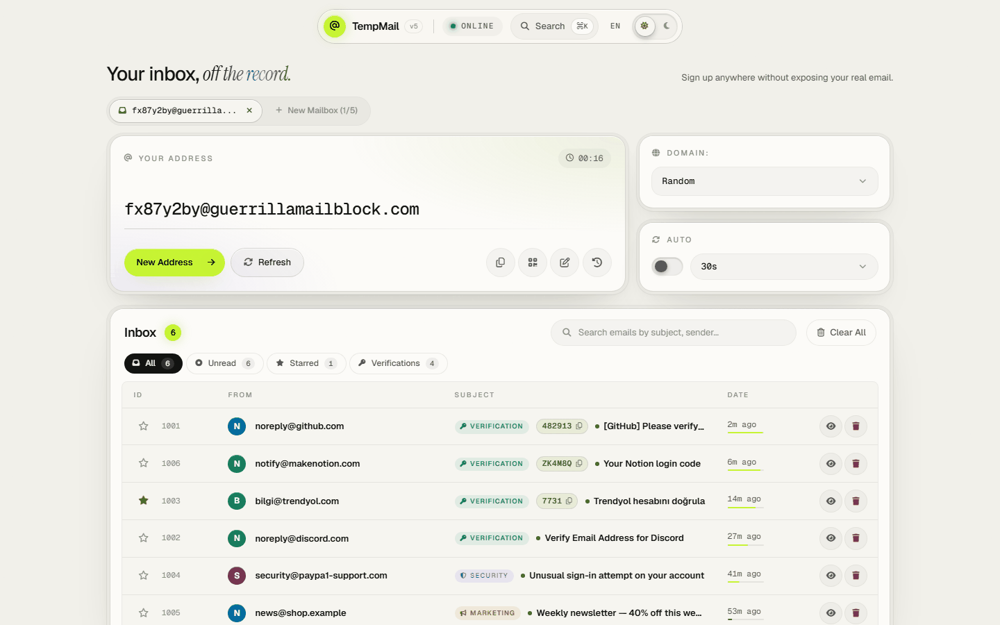</td>
  </tr>
  <tr>
    <td align="center"><sub><b>Obsidian</b> (dark)</sub></td>
    <td align="center"><sub><b>Paper</b> (light)</sub></td>
  </tr>
</table>

The theme follows your system on first visit, can be switched from the sun/moon toggle or the palette, and is applied **before the first paint** — no white flash.

<br />

## 📱 Mobile

<div align="center">
  
  &nbsp;&nbsp;
  
</div>

<br />

| Width | Layout |
|---|---|
| **≥ 1100 px** | Split reader available |
| **≤ 1024 px** | Address card full width; domain and auto-refresh cards side by side |
| **≤ 820 px** | Table becomes mail cards with big *View* buttons |
| **≤ 768 px** | Compact nav, floating **＋** quick-action button (refresh · new · copy), mail opens as a bottom sheet |
| **≤ 480 px** | Status shown as a dot only |
| **≤ 380 px** | Logo word hidden to keep the nav on one line |

<br />

## 📲 Installable PWA

TempMail installs like a native app and opens instantly, even offline.

| Platform | How to install |
|---|---|
| **Chrome / Edge** (desktop) | Install icon in the address bar, or **Install app** in the command palette |
| **Android** | Browser menu → **Install app** |
| **iOS / iPadOS** | Share → **Add to Home Screen** |

| Request | Service worker strategy |
|---|---|
| App shell (HTML, CSS, JS, icons, manifest) | **Network-first**, cached copy as offline fallback |
| Page navigation while offline | Cached `index.html` |
| Guerrilla Mail API, fonts, CDNs | **Never touched** — always live, never cached |

The installed app has a **New address** shortcut (long-press / right-click the icon) that opens TempMail and generates a fresh address.

<details>
<summary><b>Manifest summary</b></summary>

<br />

| Field | Value |
|---|---|
| `name` / `short_name` | TempMail — Disposable Email / TempMail |
| `display` | `standalone` |
| `start_url` · `scope` · `id` | `./` |
| `theme_color` · `background_color` | `#07080A` |
| Icons | 192 px, 512 px, 512 px **maskable**, SVG (`any`) |
| Shortcuts | **New address** → `./?action=new` |

</details>

<br />

## 🗣️ Languages

The whole interface ships in **English** and **Turkish** — **173 strings each**, fully paired. English is the default; the language button in the nav or the command palette switches it and the choice is remembered.

| What changes | How |
|---|---|
| Every label, toast, tooltip, `aria-label` and placeholder | `t('key')` lookup in `TRANSLATIONS.EN` / `TRANSLATIONS.TR` |
| `<html lang>` | Set to `en` / `tr` so screen readers switch voice |
| Dates & relative times | Formatted for the active language |
| Code detection, tags, verify links | Always bilingual — a Turkish mail is understood in the English UI and vice versa |

> [!TIP]
> Adding a string? Put the key in **both** `TRANSLATIONS.EN` and `TRANSLATIONS.TR` in [`js/api.js`](js/api.js) and read it with `t('key')`. A key missing in Turkish falls back to English, and one missing in both falls back to the raw key, so gaps show up immediately.

<br />

---

# 🧱 Reference

## 📁 Project structure

```text
temp-mail/
├── index.html              690  app shell, CSP, SEO / Open Graph meta, welcome tour, FAB
├── manifest.json            42  PWA manifest (icons, shortcut)
├── sw.js                    77  service worker — network-first app-shell cache
├── css/
│   └── style.css          1870  "Obsidian Signal" tokens, layout, responsive, motion, print
├── js/
│   ├── api.js             3615  the app: 101 functions, EN/TR strings, all features
│   ├── config.js            67  frozen CONFIG (API base, keys, domains, timeouts)
│   ├── theme.js             45  dark / light, system preference, theme-color meta
│   ├── guard.js             28  domain guard (runs before anything else)
│   └── watchdog.js          31  runtime re-check of the guard
├── privacy/
│   ├── privacy.html         85  privacy policy page
│   └── privacy.css         268
├── images/
│   ├── icon-192.png · icon-512.png · app-icon.svg · temp-mail-icon.png
│   └── readme/             14  screenshots + banner used in this README
├── robots.txt · sitemap.xml    search-engine files
├── LICENSE · SECURITY.md
└── README.md
```

<sub>Numbers are line counts. No `package.json`, no `node_modules`, no bundler.</sub>

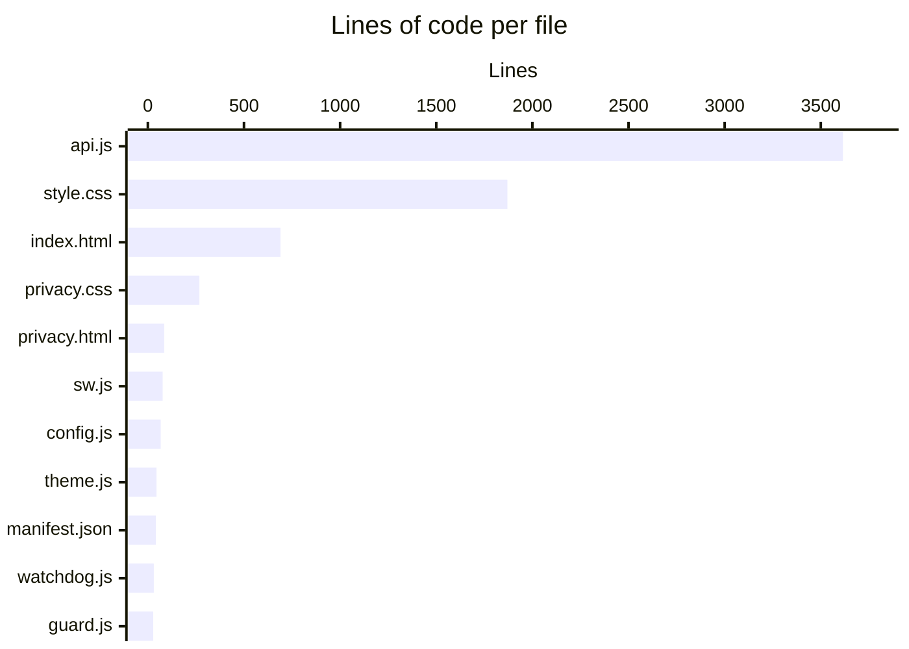

<br />

## 🏗️ Architecture

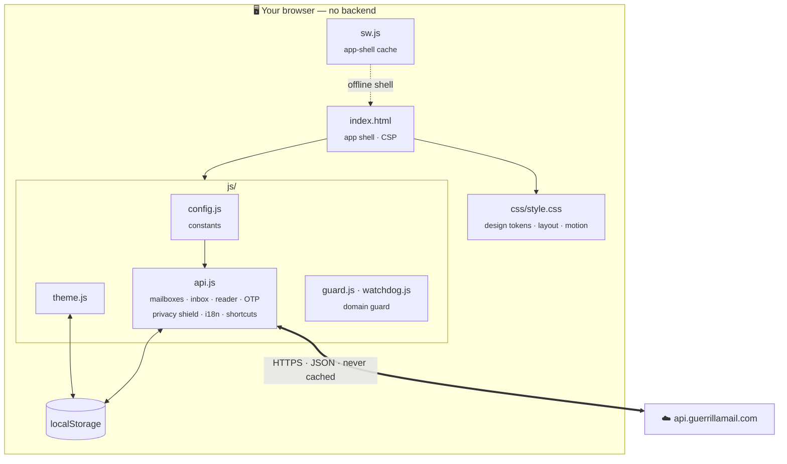

<details>
<summary><b>Module map — main functions in <code>js/api.js</code></b></summary>

<br />

| Area | Functions |
|---|---|
| Session & address | `getSession`, `genEmail`, `restoreAddress`, `copyEmail`, `copyToClipboard` |
| Mailbox tabs | `saveCurrentSession`, `renderMailboxTabs`, `switchMailbox`, `addNewMailbox`, `closeMailbox` |
| Inbox | `refreshMail`, `updateEmailTable`, `detectNewMails`, `updateEmailCount`, `renderFilterChips`, `setFilter` |
| Reading | `viewEmail`, `buildEmailViewHTML`, `wireEmailViewActions`, `openReaderPane`, `closeReaderPane`, `showEmailModal` |
| Codes | `extractVerificationCode`, `extractVerificationLink`, `copyVerificationCode`, `copyLatestCode` |
| Privacy | `sanitizeHTML`, `applyPrivacyShield`, `isTrackingPixel`, `isSuspiciousHost`, `showLinkWarningModal` |
| State | `markAsRead`, `getReadIds`, `toggleStarMail`, `pushAddressHistory`, `showAddressHistory` |
| Time | `getMailTimestamp`, `relativeTime`, `formatFullDate`, `getMailExpiry`, `refreshExpiryMeters` |
| UI | `toast`, `showCommandPalette`, `showShortcuts`, `moveMailSelection`, `updateUILanguage` |
| PWA | `installApp`, `handleManifestShortcut`, `requestNotificationPermission` |

</details>

**Script load order** — the order matters, because the guard must run before any app code:

| # | Script | Type | Why here |
|:---:|---|---|---|
| 1 | inline theme snippet | classic, `<head>` | Sets `data-theme` before first paint (no flash) |
| 2 | `guard.js` | classic, blocking | Stops the page on an unknown host |
| 3 | `watchdog.js` | `defer` | Keeps re-checking the guard while the app runs |
| 4 | `config.js` → `api.js` → `theme.js` | `type="module"` | App logic, after the DOM is parsed |
| 5 | `sw.js` | registered on `load` | Never delays first render |

<br />

## ⚙️ How it works

### Startup

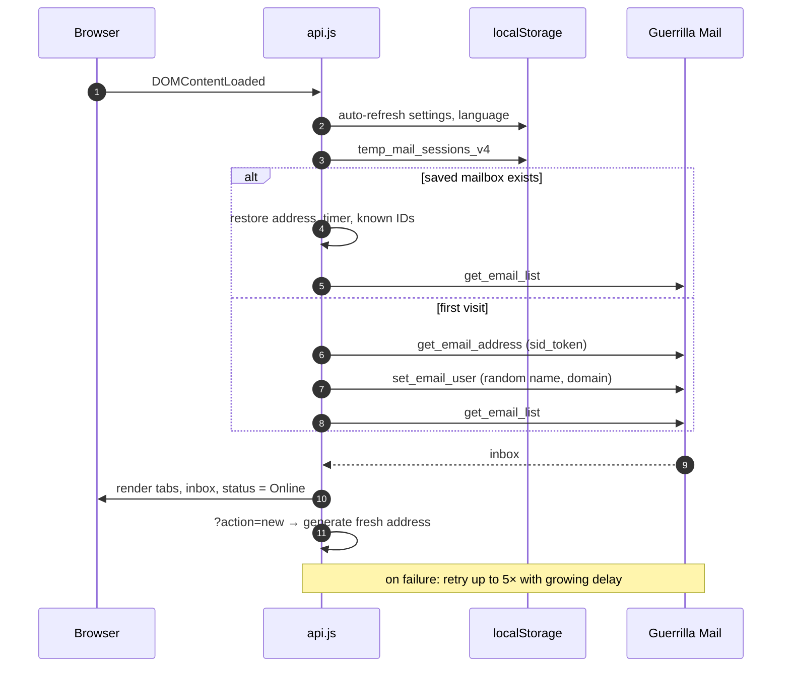

### Retry & backoff

If startup fails, TempMail retries with a delay of `RETRY_DELAY + attempt × 1500 ms`. After the 5th failure it stops and asks you to press **New Address**; while offline it also tries to reconnect every **20 s**.

| Attempt | Waits | Total elapsed |
|:---:|:---:|:---:|
| 1 → 2 | 3.5 s | 3.5 s |
| 2 → 3 | 5.0 s | 8.5 s |
| 3 → 4 | 6.5 s | 15.0 s |
| 4 → 5 | 8.0 s | 23.0 s |
| 5 | — | gives up, shows error |

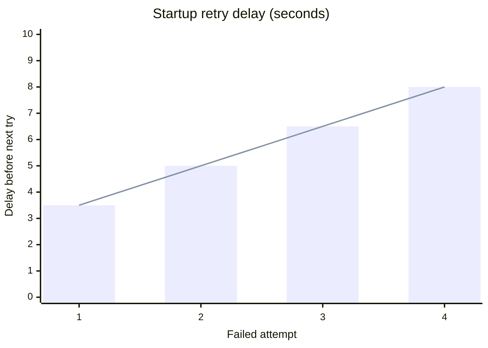

### Refresh cycle

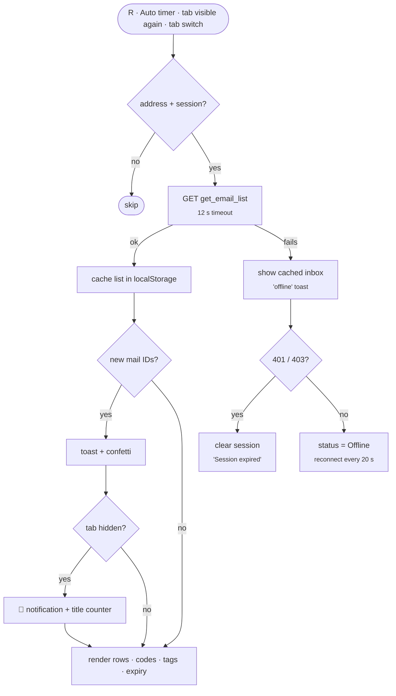

### Timers

| Timer | Interval | Source |
|---|---|---|
| Auto-refresh | 10 s · 30 s · 1 min · 2 min (off by default) | `refresh-interval` select |
| Expiry meters | every 60 s, in place | `refreshExpiryMeters` |
| Offline reconnect | every 20 s while offline | `initializeApp` |
| API timeout | 12 s per request | `fetchWithTimeout` |
| Address retry | 4 s after a failed *New Address* | `genEmail` |
| Search debounce | 250 ms | `SEARCH_DEBOUNCE` |
| Toasts | 3.5 s · 6 s for important ones | `TOAST_DURATION(_LONG)` |
| Session timer | every 1 s | `startSessionTimer` |

<br />

## 🔐 Security model

Mail content is untrusted by default. Each layer assumes the one before it can fail.

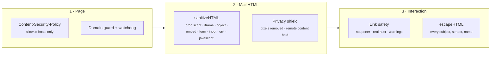

**Content-Security-Policy** (meta tag in `index.html`)

| Directive | Allows |
|---|---|
| `default-src` | `'self'`, Guerrilla Mail API, cdnjs, Google Fonts, local `ws://127.0.0.1` (live reload) |
| `connect-src` | `'self'`, `https://api.guerrillamail.com`, local websockets |
| `script-src` | `'self'`, inline |
| `style-src` | `'self'`, inline, cdnjs (Font Awesome), Google Fonts |
| `font-src` | cdnjs, `fonts.gstatic.com` |
| `img-src` | `'self'`, `data:`, any `https:` (mail images — gated by the privacy shield) |

| Threat | Mitigation |
|---|---|
| Script in a mail | Removed by `sanitizeHTML`; `on*` attributes and `javascript:` URLs stripped |
| Tracking pixel / read receipt | Tiny or hidden images removed; remote images blocked until you allow them |
| Phishing link | Text-vs-target mismatch, shorteners, raw IPs and punycode flagged, confirm before opening |
| Reverse-tabnabbing | Every external link gets `rel="noopener noreferrer nofollow"` |
| HTML in subject / sender | Always passed through `escapeHTML` |
| Calls to unknown servers | `connect-src` only allows the Guerrilla Mail API |

Found a vulnerability? See [SECURITY.md](SECURITY.md).

<br />

## 🌍 Network & third parties

There is no TempMail server. These are **all** the hosts the page talks to:

| Host | What is sent | When |
|---|---|---|
| `api.guerrillamail.com` | Session token, chosen username/domain, mail IDs | Every inbox action |
| `api.qrserver.com` | **Your temporary address** (to draw the QR image) | Only when you open the QR dialog |
| `fonts.googleapis.com` · `fonts.gstatic.com` | Standard font request | Page load |
| `cdnjs.cloudflare.com` | Standard stylesheet request (Font Awesome) | Page load |
| `cdn.jsdelivr.net` | Standard script request (canvas-confetti) | Page load |
| Remote image hosts in a mail | Standard image request | Only after **Show images** / **Always show** |

> [!NOTE]
> Everything else — stars, read state, history, cache, settings — stays in `localStorage` and never leaves your device.

<br />

## 🔌 API endpoints

All calls go to `https://api.guerrillamail.com/ajax.php` with a **12 s timeout**.

| `f=` | Method | Used for |
|---|:---:|---|
| `get_email_address` | GET | Start a session (`sid_token`) and get an address |
| `set_email_user` | POST | New, custom or restored address (`email_user`, `domain`) |
| `get_email_list` | GET | Inbox list (`offset=0`) |
| `fetch_email` | GET | Full mail body (`email_id`) |
| `del_email` | GET | Delete one or all mails (`email_ids[]`) |
| `fetch_attachment` | GET | Download an attachment |

<br />

## ⚙️ Configuration

Constants live in [`js/config.js`](js/config.js) and [`js/api.js`](js/api.js):

| Setting | Value | Purpose |
|---|---|---|
| `REQUEST_TIMEOUT` | `12000` ms | Abort slow API calls |
| `MAX_INIT_ATTEMPTS` | `5` | Startup connection retries |
| `RETRY_DELAY` | `2000` ms | Base delay before retrying address generation |
| `TOAST_DURATION` / `_LONG` | `3500` / `6000` ms | Notification toasts |
| `SEARCH_DEBOUNCE` | `250` ms | Inbox search |
| `MAIL_TTL_SECONDS` | `3600` | Expiry meter |
| Mailbox limit | `5` | Tabs |
| `ADDRESS_HISTORY_LIMIT` | `20` | History entries |
| `READ_IDS_LIMIT` | `200` per address | Read-state memory |
| Split reader | `min-width: 1100px` | When the pane is used |

<br />

## 💾 Local storage

TempMail stores **only** what it needs, **only** in your browser. Clearing site data removes all of it.

| Key | Contents |
|---|---|
| `temp_mail_sessions_v4` · `temp_mail_current_session_index` | Open mailbox tabs |
| `guerrilla_session_id` · `temp_mail_address` | Active session and address |
| `temp_mail_email_cache` · `temp_mail_known_ids` | Last inbox (offline view) and seen IDs |
| `temp_mail_starred_ids` | Starred mail |
| `temp_mail_read_ids` | Read state, per address |
| `temp_mail_address_history` | Last 20 addresses |
| `temp_mail_load_images` | `1` = always load remote images |
| `temp_mail_auto_refresh` · `temp_mail_refresh_interval` | Auto-refresh settings |
| `temp_mail_session_start` | Session timer |
| `temp_mail_lang` · `theme` · `welcomeMessageSeen` | Preferences |

<br />

## 🎨 Design system

**"Obsidian Signal"** — every color, radius and curve is a CSS custom property in [`css/style.css`](css/style.css), redefined per theme.

| Token | Dark | Light | Used for |
|---|---|---|---|
| `--bg` |  `#07080A` |  `#F1F0EA` | Page |
| `--core` |  `#0C0D10` |  `#FCFBF8` | Card surfaces |
| `--text` |  `#F2F1EC` |  `#111210` | Text |
| `--signal` |  `#D4FF3F` |  `#C6F432` | Primary buttons, codes, focus |
| `--violet` |  `#A99BFF` |  `#5B47E0` | Ambient glow, accents |
| `--success` |  `#7CF5C8` |  `#0F8F63` | Online, verification tag |
| `--warning` |  `#FFC567` |  `#B26B00` | Expiry, suspicious links |
| `--error` |  `#FF7A6B` |  `#D23F2E` | Delete, offline |

| Type | Family | Used for |
|---|---|---|
| Sans | **Geist** | Interface |
| Mono | **Geist Mono** | Addresses, codes, labels |
| Serif | **Instrument Serif** *(italic)* | Headline accent |

| Motion token | Curve | Feel |
|---|---|---|
| `--ease-out` | `cubic-bezier(0.32, 0.72, 0, 1)` | Heavy, settled |
| `--ease-spring` | `cubic-bezier(0.34, 1.4, 0.64, 1)` | Toggles, pops |
| `--ease-soft` | `cubic-bezier(0.22, 1, 0.36, 1)` | Ambient drift |

Cards use a **double-bezel** build: an outer tray (`--shell`) with a hairline ring around an inner core (`--core`) with a top highlight, using concentric radii (`--r-shell` / `--r-core`). Only `transform` and `opacity` are animated.

<br />

## ♿ Accessibility

| Area | Support |
|---|---|
| Keyboard | Every action reachable; skip link; visible `:focus-visible` rings |
| Screen readers | Labelled buttons (`aria-label`, translated), `aria-live` inbox and toasts, table caption |
| Motion | `prefers-reduced-motion` disables animations and reveals |
| Color scheme | Follows `prefers-color-scheme` on first visit |
| Language | `<html lang>` updates with EN / TR |
| Print | Print stylesheet hides navigation, controls and footer |

<br />

## 🌐 Browser requirements

TempMail targets current evergreen browsers. Key platform features it relies on:

| Feature | Used for |
|---|---|
| ES modules | App scripts |
| `:has()` selector | Empty-state rows |
| `backdrop-filter` | Floating nav, dialogs |
| RegExp lookbehind + `\p{L}` (Unicode) | Turkish code detection |
| Service Worker · Web App Manifest | Install & offline shell |
| Notifications API | Background alerts (optional) |
| Clipboard API | Copy (with `execCommand` fallback) |

<sub>Developed and tested in Chrome. Recent Edge, Firefox and Safari support all of the above.</sub>

<br />

## 📈 Project stats

<table>
<tr>
<td width="50%" valign="top">

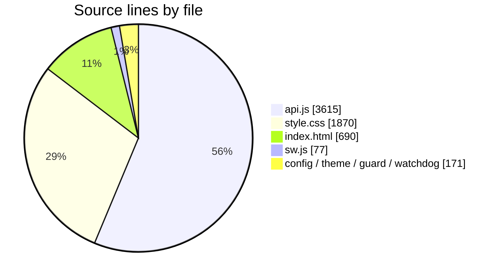

</td>
<td width="50%" valign="top">

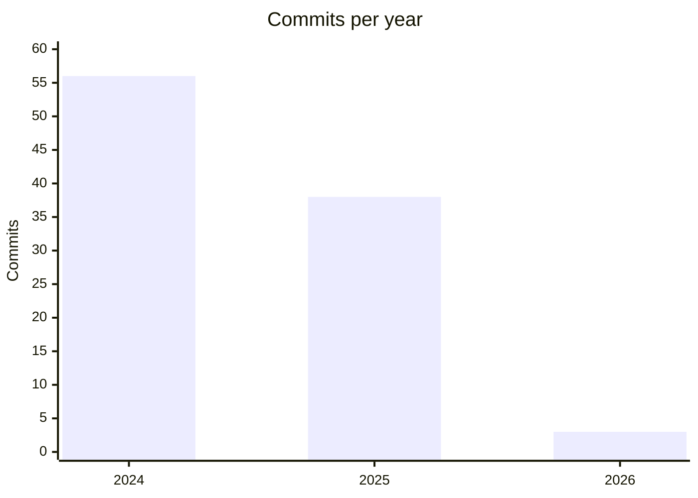

</td>
</tr>
</table>

| Metric | Value |
|---|---|
| Functions in `api.js` | **101** |
| Translation keys | **173** per language (EN = TR, fully paired) |
| README screenshots | **14**, captured from the real app |
| Runtime dependencies | **0** (Font Awesome, fonts and confetti via CDN) |

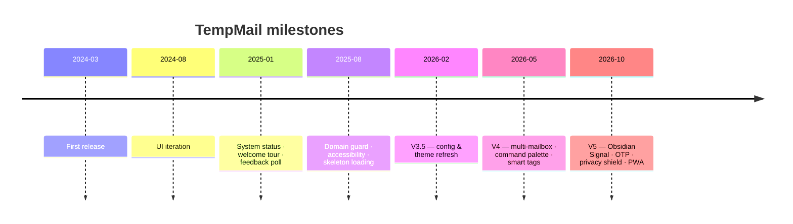

<br />

## 🛠️ Development

No toolchain — edit a file, reload the page.

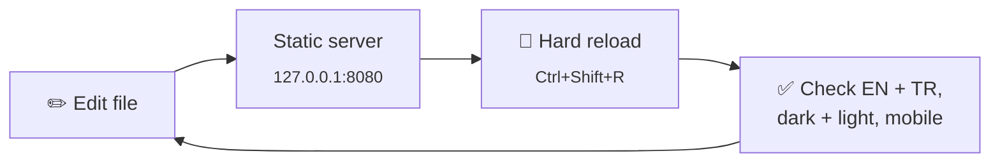

**House rules** for changes (the same ones every V5 feature followed):

| # | Rule |
|:---:|---|
| 1 | **Vanilla JS only** — no new libraries, CDNs or build step |
| 2 | Match `api.js` style: 4-space indent, `function` declarations, `// ══════` section banners, template-literal HTML |
| 3 | Every untrusted string inserted into HTML goes through `escapeHTML()` |
| 4 | Every visible string exists in **both** `TRANSLATIONS.EN` and `TRANSLATIONS.TR`, read with `t('key')` |
| 5 | Use the CSS custom properties in `style.css` — no new hard-coded colours |
| 6 | Transitions use `var(--ease-out)` or `var(--ease-spring)`; animate only `transform` and `opacity` |
| 7 | New CSS goes in a bannered section at the end of `style.css` |
| 8 | New `localStorage` keys are prefixed `temp_mail_` and parsed inside `try/catch` |
| 9 | Don't break existing features: tabs, filters, stars, palette, shortcuts, auto-refresh, QR, alias |
| 10 | Leave `config.js`, `guard.js`, `watchdog.js` and the CSP alone unless the change is about them |

**Manual test checklist**

- [ ] New address, custom username, each domain
- [ ] Mail arrives with auto-refresh on; code chip copies
- [ ] Reader: split pane (≥ 1100 px), modal, mobile sheet
- [ ] Privacy banner: *Show images* and *Always show*
- [ ] Suspicious link shows the warning
- [ ] Keyboard: J / K / Enter / S / Del / ? / Ctrl+K
- [ ] Both themes, both languages, 390 px width
- [ ] Offline: stop the network → cached inbox and *Offline* status

<br />

## 🚢 Deployment & releases

TempMail is hosted on **GitHub Pages** straight from the repository — there is nothing to build.

| Step | What to do |
|:---:|---|
| 1 | Update the version in `index.html`, `js/api.js` and `js/theme.js` headers |
| 2 | **Bump `CACHE` in `sw.js`** (e.g. `tempmail-v5-2` → `tempmail-v5-3`) so returning visitors get the new files |
| 3 | Update `sitemap.xml` `lastmod` if the page changed |
| 4 | Add a [changelog](#-changelog) entry and refresh screenshots in `images/readme/` |
| 5 | Merge to `main` — Pages publishes in about a minute |

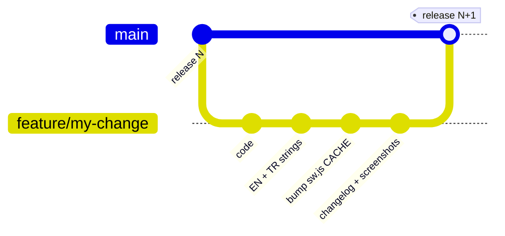

**SEO & sharing** — `index.html` carries a description, keywords, canonical URL, Open Graph and Twitter Card tags; `robots.txt` allows all crawlers and points to `sitemap.xml`.

<br />

## ⚠️ Known limitations

| Limitation | Why |
|---|---|
| **Receive only** — you can't send mail | Guerrilla Mail's API is used for receiving |
| Mail is deleted **60 min** after it arrives | Guerrilla Mail's retention, not configurable |
| Some sites reject the address | They block known disposable domains — try another domain |
| Not for anything important | Anyone who knows the address can read the inbox; never use it for banking or account recovery |
| Depends on one provider | If the Guerrilla Mail API is down, TempMail shows the cached inbox only |
| Code chip reads subject + preview | Codes buried deep in the body appear once you open the mail |
| Only EN and TR | The language toggle switches between these two |

<br />

## ❓ FAQ & troubleshooting

<details>
<summary><b>The page is blank or shows nothing when I open <code>index.html</code>.</b></summary>

<br />

Serve it over HTTP from `127.0.0.1` (see [Quick start](#-quick-start)). `file://` blocks ES modules, and the domain guard only allows `127.0.0.1` and the official site.
</details>

<details>
<summary><b>I changed the code but still see the old version.</b></summary>

<br />

The service worker cached the shell. Hard-reload, or tick **Update on reload** in DevTools → Application → Service Workers. When releasing, bump `CACHE` in `sw.js` so visitors get the new version.
</details>

<details>
<summary><b>No mail is arriving.</b></summary>

<br />

Press <kbd>R</kbd> or turn on **Auto**. Some sites block disposable domains — try another domain from the selector. If the status dot is red, the API is unreachable; TempMail retries automatically.
</details>

<details>
<summary><b>The code chip didn't appear.</b></summary>

<br />

Detection reads the subject and preview. If the code is only deep in the body, open the mail — the reader scans the full text. Codes must be 4–8 digits or 5–8 uppercase letters + digits.
</details>

<details>
<summary><b>Images in a mail are missing.</b></summary>

<br />

That's the privacy shield. Click **Show images** for that mail, or **Always show** (also in the command palette) to load them by default.
</details>

<details>
<summary><b>I don't get desktop notifications.</b></summary>

<br />

Notifications only appear while the tab is in the background. Enable them via the command palette → **Enable desktop notifications**; if your browser blocked them earlier, allow them in the site settings.
</details>

<details>
<summary><b>Can I get an old address back?</b></summary>

<br />

Yes — **Address history** (clock button). The inbox comes back, but mail older than 60 minutes has been deleted by Guerrilla Mail.
</details>

<details>
<summary><b>Is any of my data sent to a TempMail server?</b></summary>

<br />

No. There is no TempMail server. Mail is fetched directly from Guerrilla Mail; preferences live in `localStorage`. The only other service that ever sees your temporary address is the QR image generator, and only when you open the QR dialog — see [Network & third parties](#-network--third-parties).
</details>

<br />

## 📝 Changelog

<details open>
<summary><b>V5.0 — October 2026</b></summary>

<br />

**Added**
- "Obsidian Signal" design system with dark and light themes, app-density layout, floating nav
- One-click verification codes (inbox chip, reader strip, verify-link button, *Copy latest code*)
- Split reader pane, single-click open, mobile bottom sheet
- Privacy shield (tracking pixels removed, remote content blocked) and link safety warnings
- Read / unread state and **Unread** filter
- Address history (last 20)
- Keyboard navigation: J · K · ↑ · ↓ · Enter · O · S · Del · #
- Background-only notifications with tab counter; per-mail 60-minute expiry meter
- Installable PWA: service worker, manifest, 192/512 + maskable icons, *New address* shortcut

**Changed**
- English is the default language (your choice is still remembered)
- Notification permission is no longer requested on page load

**Fixed**
- Mails without a valid timestamp showed *01.01.1970*
- *Copy text* could copy the wrong mail
- Missing translations in the command palette hint and welcome tips
- Removed the broken *Activity Log* button
</details>

<details>
<summary><b>V4.0 — May 2026</b></summary>

<br />

Multi-mailbox tabs (up to 5) · command palette · smart semantic tags · starring · filter chips · aurora background · noise overlay.
</details>

<details>
<summary><b>V3.5 — February 2026</b></summary>

<br />

Configuration and theme handling refresh.
</details>

<br />

---

## ⭐ Star history

<div align="center">
  <a href="https://star-history.com/#mehmetkahya0/temp-mail&Date">
    <picture>
      <source media="(prefers-color-scheme: dark)" srcset="https://api.star-history.com/svg?repos=mehmetkahya0/temp-mail&type=Date&theme=dark" />
      
    </picture>
  </a>
  <br /><br />
  
</div>

<br />

## 👤 Author

<div align="center">
  <a href="https://github.com/mehmetkahya0">
    
  </a>
  <br />
  <b>Mehmet Kahya</b>
  <br /><br />

[](https://github.com/mehmetkahya0)
[](https://linkedin.com/in/mehmet-kahya-0861a4286)
[](mailto:mehmetkahyakas5@gmail.com)

</div>

<br />

## 📜 License & thanks

**Proprietary — all rights reserved.** The source is public to read, not to reuse: no copying, redeploying, modifying or commercial use without the author's written permission. Using the [official site](https://mehmetkahya0.github.io/temp-mail/) is free for everyone. See [LICENSE](LICENSE) and [SECURITY.md](SECURITY.md).

| Thanks to | For |
|---|---|
| [Guerrilla Mail](https://www.guerrillamail.com/) | The temporary email API |
| [Geist](https://vercel.com/font) · [Instrument Serif](https://fonts.google.com/specimen/Instrument+Serif) | Typography |
| [Font Awesome](https://fontawesome.com/) | Icons |
| [canvas-confetti](https://github.com/catdad/canvas-confetti) | Celebrations 🎉 |
| Everyone who reported bugs and tested | Making it better |

<br />

<div align="center">
<sub>⚠️ <b>Disclaimer:</b> This project is purely for educational purposes. We do not allow illegal activities to be performed using this project and are not responsible for any incidents that may occur. Use it legally and responsibly.</sub>
</div>
